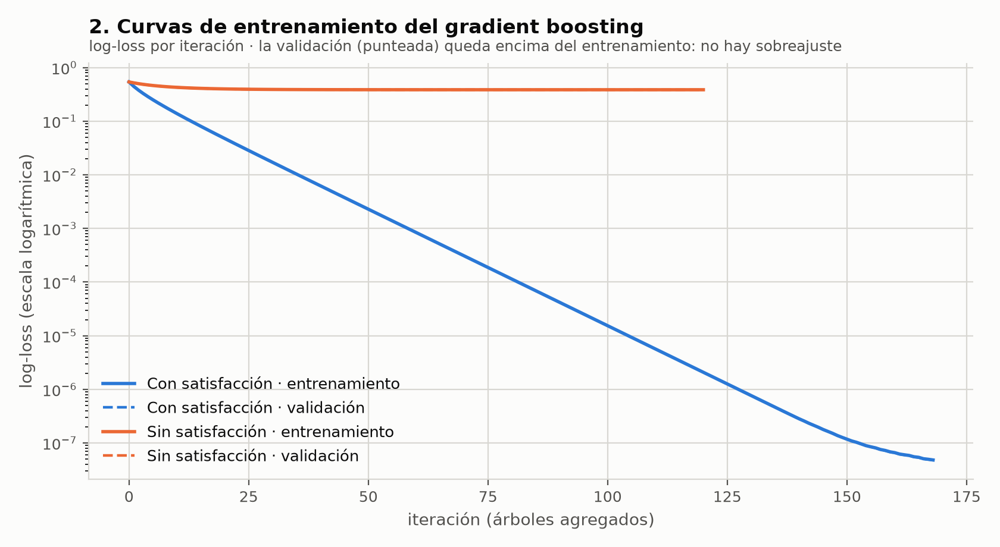
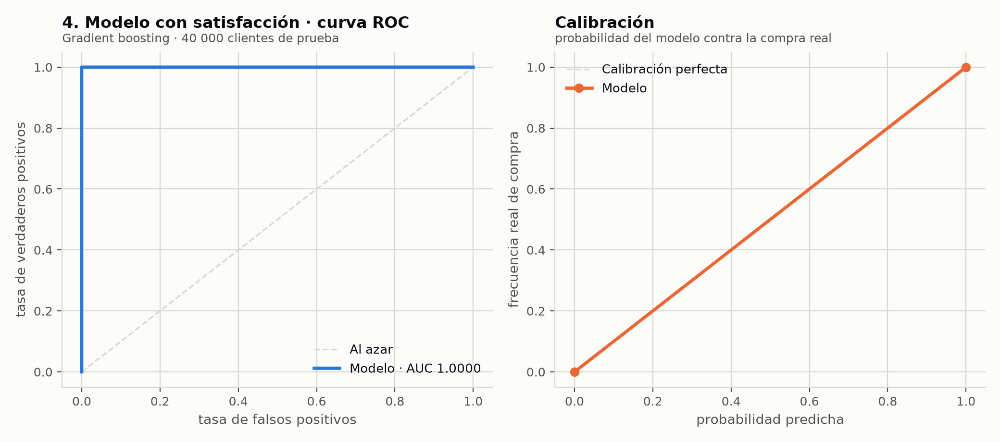
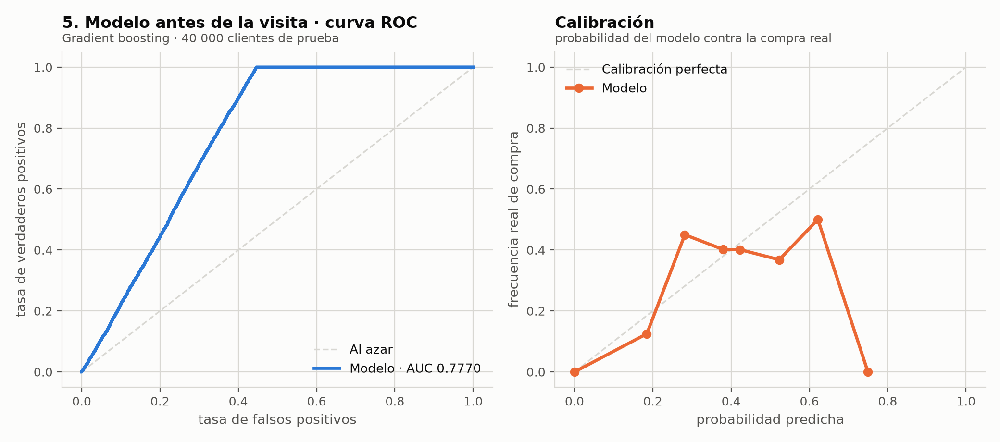

# Predicción de compra de vivienda

Modelo que estima la probabilidad de que un cliente compre una vivienda, entrenado con el dataset
[Global House Purchase Decision](https://www.kaggle.com/datasets/mohankrishnathalla/global-house-purchase-decision-dataset)
(200 000 clientes), registrado en DagsHub y publicado como app web en Azure para asesores
inmobiliarios.

## Enlaces de la entrega

| | Enlace |
|---|---|
| 1. App en línea | **https://prediccion-compra-vivienda.azurewebsites.net** |
| 2. Estadísticas y gráficas de entrenamiento | **https://dagshub.com/garmendiavictor03/prediccion-compra-vivienda/experiments** |
| Código | https://github.com/gxrmendix/prediccion-compra-vivienda |

En DagsHub hay 8 corridas: para cada uno de los dos modelos (con y sin la calificación de la
visita), una línea base, una regresión logística, un gradient boosting con todas las variables y
uno de referencia con solo las variables importantes. Las dos marcadas con `seleccionado = si`
son las que usa la app; tienen métricas de validación y prueba, la curva de pérdida por
iteración, la importancia de cada variable y las figuras como artefactos.

## Dónde está cada parte

| Parte | Archivo | Figura | Commit |
|---|---|---|---|
| 1. Datos y división 70/10/20 | [`src/preparar_datos.py`](src/preparar_datos.py) | — | "Preparacion de datos: …" |
| 2. Variables y modelos | [`src/entrenar.py`](src/entrenar.py), [`app/caracteristicas.py`](app/caracteristicas.py) | `figuras/01-…`, `02-…`, `03-…` | "Entrenamiento: …" |
| 3. Evaluación en prueba | [`src/entrenar.py`](src/entrenar.py) | `figuras/04-…`, `05-…` | "Entrenamiento: …" |
| 4. App web | [`app/app.py`](app/app.py), [`app/templates/`](app/templates), [`app/static/`](app/static) | — | "App web: …" |
| 5. Despliegue en Azure | [`desplegar.sh`](desplegar.sh) | — | "Despliegue: …" |

Los números de cada corrida quedan en `resultados/*.json`; `src/estilo.py` solo define el estilo
común de las figuras. La carpeta `app/` es lo único que se sube a Azure, con su propio
`requirements.txt` más ligero.

## Cómo correr

```bash
conda create -y -n compra python=3.11 && conda activate compra
pip install -r requirements.txt

sh descargar_datos.sh             # requiere el token de Kaggle en ~/.kaggle/access_token
python src/preparar_datos.py      # división 70/10/20                     (~5 s)
python src/entrenar.py            # modelos, figuras y subida a DagsHub   (~50 s)
python app/app.py                 # app local en http://127.0.0.1:8000
sh desplegar.sh                   # publica app/ en Azure (requiere az login)
```

`python src/entrenar.py --sin-dagshub` entrena sin subir nada.

---

## Parte 1 — Datos y división 70/10/20

**Qué pide:** usar 70 % para entrenamiento, 20 % para prueba y 10 % para validación.

**Cómo se hizo.** El dataset tiene 200 000 clientes, 25 columnas y ningún valor faltante; el
23.03 % compró. La división es **estratificada** por la decisión (las tres partes conservan el
23.03 %) y se hace **antes de cualquier preprocesamiento**, para que nada de la prueba influya en
el modelo:

| Parte | Clientes | Para qué se usa |
|---|---|---|
| Entrenamiento | 140 000 (70 %) | ajustar los modelos |
| Validación | 20 000 (10 %) | elegir el modelo y medir la importancia de las variables |
| Prueba | 40 000 (20 %) | medir una sola vez el modelo elegido |

**Dos relaciones exactas que aprovecha la app.** Se comprobaron en las 200 000 filas:

- `precio = enganche + crédito hipotecario`. Por eso la app pide el precio y el enganche, como en
  una venta real, y calcula el crédito.
- `emi_to_income_ratio` (mensualidad entre ingreso) es la mensualidad de un crédito amortizado al
  **6.5 % anual** dividida entre el ingreso mensual, redondeada a 2 decimales. La app la calcula con
  la misma función que usa el entrenamiento ([`app/caracteristicas.py`](app/caracteristicas.py)).

---

## Parte 2 — Variables y modelos

**Qué pide:** predecir si un cliente comprará una casa dadas sus características.

**Las variables.** Se usan las 23 características que un vendedor puede conocer: ubicación y
entorno (país, ciudad, calificación del vecindario, conectividad, delitos en la zona), la vivienda
(tipo, amueblado, superficie, año de construcción, recámaras, baños, cochera, jardín, dueños
anteriores, casos legales), el comprador (ingreso y gastos mensuales), el crédito hipotecario
(precio, enganche, crédito, plazo, mensualidad/ingreso) y la calificación de la visita. Las
categorías se codifican como enteros con un orden fijo, que el gradient boosting trata como
categóricas.

**La calificación de la visita solo existe después de la visita.** Por eso hay dos modelos: uno
con las 23 variables y otro "antes de la visita" con 22. La app usa el que corresponde según si el
vendedor llena ese dato.

**Los candidatos.** En cada modelo compiten:

- **Línea base:** responde siempre la tasa de compra (23 %). Sirve para saber si los otros
  aprenden algo.
- **Regresión logística**, con las categorías en one-hot y los números estandarizados.
- **Gradient boosting** (`HistGradientBoostingClassifier`), con parada temprana cuando 20 árboles
  seguidos no mejoran.
- **Referencia reducida:** el mismo gradient boosting con solo las variables importantes, para
  comprobar si el resto aporta algo. No compite por la app, porque la app recibe todo el formulario.

Se elige el de **menor log-loss en validación** y no el de mayor exactitud: la app entrega una
*probabilidad*, y el log-loss castiga las probabilidades mal calibradas.

### El hallazgo principal: solo 4 variables deciden

Un gradient boosting con las 23 variables llega a **AUC 1.0 en validación**, algo que no pasa con
datos reales. Para entender por qué se midió cuánto aporta cada variable: se revuelven sus valores
en validación y se ve cuánto empeora el modelo.


Solo 4 variables aportan; las otras 19 tienen importancia prácticamente cero. Un árbol de
decisión de profundidad 4 sobre esas 4 reproduce la decisión en las 200 000 filas:

> **Compra solo si** la calificación de la visita es **7 o más**, la propiedad **no tiene casos
> legales**, hay **2 delitos reportados o menos** y la mensualidad es **39 % del ingreso o menos**.
> Si falla cualquiera de las cuatro, no compra.

El dataset es **sintético**: la etiqueta es una regla, y cualquier modelo flexible llega al 100 %.
Se reporta así en lugar de presentar el 100 % como mérito del modelo. El precio, el enganche, el
plazo y el ingreso sí cuentan, pero solo a través de la mensualidad.



Con la calificación de la visita la pérdida baja de forma constante hasta 10⁻⁷: el modelo encontró
la regla. Antes de la visita se estanca en 0.39, porque lo que falta para decidir no está en los
datos. En los dos casos la validación queda encima del entrenamiento: no hay sobreajuste general.


La regresión logística se queda en 0.986 porque la regla es un "y" de cuatro umbrales, que una
frontera lineal no puede representar. Con todas las variables o con solo las importantes, el
gradient boosting da prácticamente lo mismo (0.778 contra 0.776 antes de la visita).

---

## Parte 3 — Evaluación en prueba

Solo el modelo elegido de cada variante se evalúa, una vez, en los 40 000 clientes de prueba.



**Con la calificación de la visita:** 30 787 verdaderos negativos, 9 213 verdaderos positivos y
**ningún error**.



**Antes de la visita:** AUC 0.777. Aquí la exactitud engaña (76.83 %, casi lo mismo que decir
siempre "no"): aun con la casa y el crédito en orden, solo 4 de cada 10 clientes terminan con una
calificación de 7 o más, así que el modelo rara vez pasa de 50 %. Lo valioso es la
**probabilidad**: cuando se cumplen las otras tres condiciones predice en promedio 40.2 % y compra
el 40.1 %; cuando no, predice prácticamente 0 % y nadie compra.

**El costo de usar todas las variables.** Para esos clientes la probabilidad real es ~40 % para
todos, pero el modelo con 22 variables la dispersa entre 31 % y 50 % (percentiles 1 y 99), y 212
de 40 000 pasan de 50 %. Esa dispersión es ruido: el modelo cree ver patrones en variables que no
influyen. El modelo reducido de 3 variables dispersa menos (34 clientes sobre 50 %). Se usa el de
22 porque la app recibe todo el formulario; la diferencia en log-loss de validación es de 0.0005.

| Métrica en prueba | Con visita | Antes de la visita | Línea base |
|---|---|---|---|
| AUC | **1.0000** | **0.7770** | 0.5000 |
| Log-loss | 0.0000 | 0.3880 | 0.5397 |
| Brier | 0.0000 | 0.1386 | 0.1773 |
| Exactitud (umbral 0.5) | 100.00 % | 76.83 % | 76.97 % |
| Precisión (umbral 0.5) | 100.00 % | 37.26 % | — |
| Exhaustividad (umbral 0.5) | 100.00 % | 0.86 % | 0 % |

---

## Parte 4 — App web

**Qué pide:** una app en la nube donde el usuario llene un formulario con datos que un vendedor
pueda conseguir y reciba la probabilidad de que el cliente compre.

**El formulario**, en cinco pasos:

| Paso | Campos |
|---|---|
| 1. Ubicación y entorno | país, ciudad (filtrada por país), calificación del vecindario y conectividad (1 a 10), delitos en la zona |
| 2. La vivienda | tipo, superficie en m², año de construcción, recámaras, baños, dueños anteriores, amueblado, cochera, jardín, caso legal |
| 3. El comprador | ingreso y gastos mensuales |
| 4. Crédito hipotecario | precio y enganche; el crédito, la mensualidad y su porcentaje del ingreso se calculan solos |
| 5. La visita (opcional) | calificación del 1 al 10 |

No se pide la edad del comprador ni su historial crediticio porque el dataset no los tiene: un
modelo no puede usar un dato que nunca vio.

**El resultado** muestra la probabilidad en un medidor, un nivel (muy probable, posible o poco
probable), las 4 condiciones con ✓ o ✗ y, si la mensualidad es muy alta, cuánto enganche o qué plazo
la harían pagable. Abajo, la sección "Cómo funciona este modelo" explica los datos, la división,
el modelo, las métricas y las limitaciones, para que se pueda usar en clase. Tres botones cargan
ejemplos (cliente ideal, antes de la visita y caso con problemas).

**Interactividad.** Con JavaScript el resultado se recalcula en vivo al cambiar cualquier dato
(el navegador pide al servidor solo el panel del resultado), el medidor se llena y el porcentaje
cuenta hasta su valor, las condiciones aparecen una por una y las casas del encabezado se mueven.
Sin JavaScript el formulario funciona igual con su botón. Las animaciones se apagan si el sistema
pide reducir movimiento.

**Seguridad.** HTTPS obligatorio, política de contenido que solo permite recursos propios y las
fuentes de Google, sin incrustarse en otras páginas (`frame-ancestors 'none'`), escape de todo lo
que escribe el usuario, rechazo de valores fuera del rango con que se entrenó el modelo (incluidos
`nan` e infinitos) y FTP de publicación desactivado.

**Verificaciones:**

| | Comprobación | Resultado |
|---|---|---|
| 1 | La app contra la decisión real de 300 clientes de prueba, llenando los 21 campos | 300 de 300 |
| 2 | En Chrome: cambiar la visita a 5, quitarla, cambiar el enganche, elegir Singapur, dejar la ciudad vacía | el resultado y los cálculos se actualizan solos; sin errores de JavaScript ni de seguridad |
| 3 | Celular emulado a 390 px | el documento mide 390 px: no se desborda |
| 4 | Datos inválidos (texto, ciudad de otro país, enganche de 4 %, ingreso de 1) | mensaje claro, sin calcular |
| 5 | Código malicioso en un campo (`<script>`) | se muestra como texto |

---

## Parte 5 — Despliegue en Azure

Azure App Service, plan **F1 (gratuito)**, Linux, Python 3.12, región West US.

[`desplegar.sh`](desplegar.sh) descarga en la computadora local las librerías ya compiladas para
Linux, las empaqueta con la app y desactiva la compilación en el servidor. Esto no es un detalle:
en los primeros despliegues Azure instalaba numpy, scipy y scikit-learn en el servidor, eso agotó
la cuota diaria de 60 minutos de CPU del plan gratuito y **Azure deshabilitó el sitio hasta el día
siguiente** (`QuotaExceeded`). Con el paquete ya compilado el servidor solo descomprime, y la CPU
diaria queda para atender visitas: cada predicción tarda milisegundos.

---

## Problemas que se presentaron

1. **La etiqueta es una regla exacta.** Con 4 variables se reproduce el 100 % de las decisiones.
   Se documentó en lugar de presentar el 100 % como mérito del modelo, y se agregó el modelo
   "antes de la visita" para que la app dé probabilidades útiles.
2. **La calificación solo existe después de la visita.** De ahí los dos modelos.
3. **Usar todas las variables agrega ruido.** El modelo antes de la visita con 22 variables
   dispersa las probabilidades más que el de 3; se aceptó porque la app recibe todo el formulario
   y la pérdida casi no cambia.
4. **Azure deshabilitó la app por cuota.** Compilar las librerías en el servidor gastó la CPU
   diaria del plan F1; se resolvió desplegando las librerías ya compiladas.
5. **Azure for Students.** La suscripción solo permite 5 regiones y en North Central US el cupo
   F1 es 0; se usó West US. `az webapp up` ya no existe; se usó `az webapp create` + `az webapp deploy`.
6. **Subida lenta a DagsHub.** Registrar cada punto de las curvas por separado tardaba más de 10
   minutos; con `log_batch` tarda unos 30 segundos.
7. **Instalación en Mac Intel.** `cryptography` y la librería OpenMP de LightGBM no tienen paquete
   precompilado para esta Mac; se instalaron desde conda-forge, y la app usa el gradient boosting
   de scikit-learn, que no depende de nada extra en el servidor.

## Costo estimado por mes

Precios de lista de Azure (API pública de precios, Linux, West US, 730 horas al mes):

| Plan de App Service | Qué incluye | USD por mes |
|---|---|---|
| **F1 Free (el que se usa)** | 1 GB de RAM, 60 min de CPU al día, se duerme sin uso | **0.00** |
| B1 Basic | 1 núcleo, 1.75 GB, siempre encendida | 13.14 |
| P0v3 Premium | 1 núcleo, 4 GB, escalado automático | 63.87 |
| S1 Standard | 1 núcleo, 1.75 GB, escalado y respaldos | 69.35 |

DagsHub (plan comunitario) y GitHub (repositorio público) no cuestan. **Mantener la app en línea
cuesta 0 USD al mes.** Con mucho tráfico, o para que no tarde unos segundos en despertar tras un
rato sin uso, el plan B1 costaría 13.14 USD al mes, que el crédito de 100 USD de Azure for Students
cubriría por unos 7 meses.

## Resultados

| Qué se midió | Resultado |
|---|---|
| Variables que deciden, de 23 | **4** (las demás: importancia prácticamente 0) |
| Regla que reproduce la etiqueta | 200 000 de 200 000 filas |
| AUC en prueba, con la visita | **1.0000** (0 errores en 40 000) |
| AUC en prueba, antes de la visita | **0.7770** (calibrado: predice 40.2 %, compra el 40.1 %) |
| App contra decisiones reales | 300 de 300 |
| Costo mensual de la app | **0 USD** (Azure F1) |

## Entorno

macOS sobre Mac Intel sin GPU. Python 3.11 para entrenar (Python 3.12 en Azure), scikit-learn
1.9.1, numpy 2.4.6, MLflow 3.18, Flask 3.1. Todo usa la semilla 42, así que las corridas son
reproducibles: las métricas salieron idénticas en todas las corridas.
