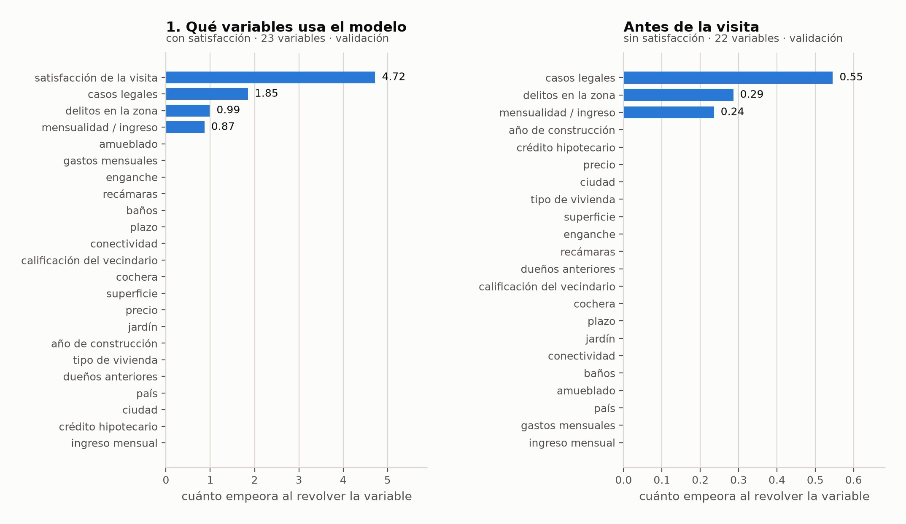
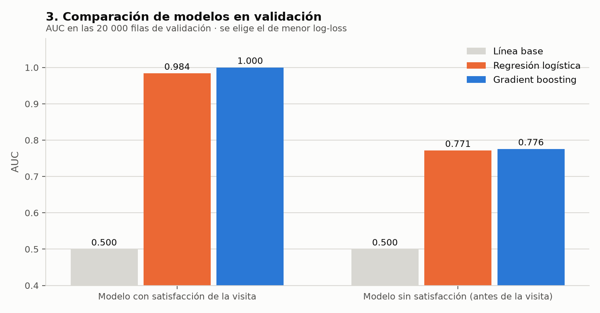

# Predicción de compra de vivienda

Modelo que estima la probabilidad de que un cliente compre una casa, entrenado con el dataset
[Global House Purchase Decision](https://www.kaggle.com/datasets/mohankrishnathalla/global-house-purchase-decision-dataset)
(200 000 clientes), registrado en DagsHub y publicado como app web en Azure.

## Enlaces de la entrega

| | Enlace |
|---|---|
| 1. App en línea | **https://prediccion-compra-vivienda.azurewebsites.net** |
| 2. Estadísticas y gráficas de entrenamiento | **https://dagshub.com/garmendiavictor03/prediccion-compra-vivienda/experiments** |
| Código | https://github.com/gxrmendix/prediccion-compra-vivienda |

En DagsHub hay 7 corridas: la de selección de variables y, para cada uno de los dos modelos, una
línea base, una regresión logística y un gradient boosting. Las dos marcadas con
`seleccionado = si` son las que usa la app; cada una tiene sus métricas de validación y prueba,
la curva de pérdida por iteración y sus figuras como artefactos.

## Dónde está cada parte

| Parte | Archivo | Figura | Commit |
|---|---|---|---|
| 1. Datos y división 70/10/20 | [`src/preparar_datos.py`](src/preparar_datos.py) | — | "Preparacion de datos: …" |
| 2. Qué variables importan | [`src/entrenar.py`](src/entrenar.py) | `figuras/01-importancia-variables.png` | "Entrenamiento: …" |
| 3. Modelos y registro en DagsHub | [`src/entrenar.py`](src/entrenar.py) | `figuras/02-…`, `figuras/03-…` | "Entrenamiento: …" |
| 4. Evaluación en prueba | [`src/entrenar.py`](src/entrenar.py) | `figuras/04-…`, `figuras/05-…` | "Entrenamiento: …" |
| 5. App web en Azure | [`app/app.py`](app/app.py), [`app/templates/index.html`](app/templates/index.html) | — | "App web: …" |

Los números de cada corrida quedan en `resultados/*.json`; `src/estilo.py` solo define el estilo
común de las figuras. La carpeta `app/` es lo único que se sube a Azure, con su propio
`requirements.txt` más ligero.

## Cómo correr

```bash
conda create -y -n compra python=3.11 && conda activate compra
pip install -r requirements.txt

sh descargar_datos.sh             # requiere el token de Kaggle en ~/.kaggle/access_token
python src/preparar_datos.py      # division 70/10/20                     (~5 s)
python src/entrenar.py            # modelos, figuras y subida a DagsHub   (~45 s)
python app/app.py                 # app local en http://127.0.0.1:8000
```

`python src/entrenar.py --sin-dagshub` entrena sin subir nada.

---

## Parte 1 — Datos y división 70/10/20

**Qué pide:** usar 70 % para entrenamiento, 20 % para prueba y 10 % para validación.

**Cómo se hizo.** El dataset tiene 200 000 clientes, 25 columnas y ningún valor faltante. El
23.03 % compró. La división es **estratificada** por la decisión (las tres partes conservan el
23.03 %) y se hace **antes de cualquier preprocesamiento**, para que nada de la prueba influya en
el modelo:

| Parte | Filas | Para qué se usa |
|---|---|---|
| Entrenamiento | 140 000 (70 %) | ajustar los modelos |
| Validación | 20 000 (10 %) | elegir variables y modelo |
| Prueba | 40 000 (20 %) | medir una sola vez el modelo elegido |

**La mensualidad se puede calcular.** La columna `emi_to_income_ratio` (mensualidad entre
ingreso) es la mensualidad de un préstamo amortizado al **6.5 % anual** dividida entre el salario
mensual, redondeada a 2 decimales. Coincide en **200 000 de 200 000 filas**. Por eso la app no le
pide al vendedor ese cociente: pide salario, préstamo y plazo, y lo calcula con la misma función
(`app/caracteristicas.py`) que usó el entrenamiento.

---

## Parte 2 — Qué variables importan

**El hallazgo principal del proyecto.** Un gradient boosting con las 23 variables llega a
**AUC 1.0 en validación**. Eso no es normal en un problema real, así que se midió cuánto aporta
cada variable: se revuelven sus valores en validación y se ve cuánto empeora el modelo.



Solo 4 variables aportan; las otras 19 (país, ciudad, precio, tamaño, cuartos, salario, enganche…)
tienen importancia **exactamente cero**. Un árbol de decisión de profundidad 4 sobre esas 4
variables reproduce la decisión en las 200 000 filas. La etiqueta del dataset es esta regla:

> **Compra solo si** la satisfacción del cliente es **7 o más**, la propiedad **no tiene casos
> legales**, hay **2 delitos reportados o menos** y la mensualidad es **39 % del salario o menos**.
> Si falla cualquiera de las cuatro, no compra.

Es decir, el dataset es **sintético**: no hay nada que "aprender" más allá de esa regla, y
cualquier modelo flexible llega al 100 %. Se reporta así en lugar de presentar el 100 % como un
logro.

**La satisfacción se mide después de la visita.** Un vendedor la conoce solo cuando el cliente
ya vio la casa. Por eso se entrenaron **dos modelos**:

| Modelo | Variables | Cuándo lo usa la app |
|---|---|---|
| Con satisfacción | satisfacción, casos legales, delitos, mensualidad/salario | el vendedor ya tiene la calificación de la visita |
| Sin satisfacción | casos legales, delitos, mensualidad/salario | todavía no hay visita |

---

## Parte 3 — Modelos y registro en DagsHub

**Qué pide:** registrar los entrenamientos en una plataforma en línea.

**Cómo se hizo.** Para cada uno de los dos modelos compiten tres candidatos:

- **Línea base:** responde siempre la tasa de compra (23 %). Sirve para saber si los otros
  aprenden algo.
- **Regresión logística** con variables estandarizadas.
- **Gradient boosting** (`HistGradientBoostingClassifier` de scikit-learn) con parada temprana:
  deja de agregar árboles cuando 20 seguidos no mejoran.

Se elige el de **menor log-loss en validación**, no el de mayor exactitud: la app entrega una
*probabilidad*, y el log-loss castiga las probabilidades mal calibradas.


Con la satisfacción, la pérdida baja de forma constante hasta 10⁻⁷: el modelo encontró la regla
exacta. Sin la satisfacción se estanca en 0.39 desde la iteración 25, porque lo que falta para
decidir no está en los datos. En los dos casos la curva de validación queda encima de la de
entrenamiento: no hay sobreajuste.



La regresión logística se queda en 0.984 con la satisfacción porque la regla es un "y" de cuatro
umbrales, que una frontera lineal no puede representar. El gradient boosting sí, y gana en las dos
variantes.

**El registro.** Todo se acumula en memoria y se sube al final, una petición por corrida
(`log_batch`). La primera versión subía métrica por métrica y tardaba más de 10 minutos; en lote
tarda 26 segundos.

---

## Parte 4 — Evaluación en prueba

Solo el modelo elegido de cada variante se evalúa, una sola vez, en los 40 000 clientes de prueba.


**Con satisfacción:** 30 787 verdaderos negativos, 9 213 verdaderos positivos, **ningún error**.


**Sin satisfacción:** AUC 0.78. Aquí la exactitud engaña (76.95 %, igual que decir siempre
"no") porque el modelo **casi nunca pasa de 50 %**: aun cuando la casa y el préstamo están bien,
solo 4 de cada 10 clientes terminan con satisfacción de 7 o más. Solo 34 de los 40 000 clientes
de prueba superan el 50 %, y los 34 tienen la misma combinación poco frecuente (2 delitos y
mensualidad del 36 %), donde el modelo se pasa: predice más de 50 % y compra el 38 %. Es un
sobreajuste pequeño en una celda con pocos datos. Lo que sí hace bien es la
**probabilidad**: cuando se cumplen las otras tres condiciones predice 40.1 % y compra el 40.1 %;
cuando no, predice 0 % y nadie compra. La curva de calibración queda sobre la diagonal.

| Métrica en prueba | Con satisfacción | Sin satisfacción | Línea base |
|---|---|---|---|
| AUC | **1.0000** | **0.7813** | 0.5000 |
| Log-loss | 0.0000 | 0.3868 | 0.5397 |
| Brier | 0.0000 | 0.1380 | 0.1773 |
| Exactitud (umbral 0.5) | 100.00 % | 76.95 % | 76.97 % |
| Precisión (umbral 0.5) | 100.00 % | 38.24 % | — |
| Exhaustividad (umbral 0.5) | 100.00 % | 0.14 % | 0 % |

---

## Parte 5 — App web en Azure

**Qué pide:** una app en la nube donde el usuario llene un formulario con datos que un vendedor
pueda conseguir y reciba la probabilidad de compra.

**El formulario** pide solo lo que el modelo usa y que un vendedor puede obtener:

| Campo | De dónde lo saca el vendedor |
|---|---|
| ¿Caso legal abierto? | expediente de la propiedad |
| Delitos reportados en la zona | estadísticas de seguridad de la colonia |
| Salario mensual | lo declara el cliente para el crédito |
| Monto y plazo del préstamo | la simulación de crédito |
| Calificación de la visita (opcional) | se le pregunta al cliente después de ver la casa |

Si el vendedor llena la calificación se usa el modelo con satisfacción; si no, el de antes de la
visita. La app muestra la probabilidad, la mensualidad calculada y qué condición la está bajando
(por ejemplo "la mensualidad sería el 62 % del salario").

**Despliegue.** Azure App Service, plan **F1 (gratuito)**, Linux, Python 3.12, región West US.
La app usa Flask y scikit-learn sin pandas, para caber holgada en el plan gratuito, y fija las
mismas versiones de numpy y scikit-learn del entrenamiento para que los modelos carguen igual.
Además del formulario expone `POST /api/prediccion` (JSON) y `GET /salud`.

**Verificaciones:**

| | Comprobación | Resultado |
|---|---|---|
| 1 | La app local contra la decisión real de 300 clientes de prueba | 300 de 300 |
| 2 | La app en Azure contra la local, mismos 3 casos | probabilidades idénticas |
| 3 | Formulario con datos inválidos (texto, plazo inexistente) | mensajes de error, sin caerse |

---

## Problemas que se presentaron

1. **La etiqueta es una regla exacta.** Con 4 variables se reproduce el 100 % de las decisiones y
   las otras 19 no sirven. Se documentó en lugar de presentar el 100 % como mérito del modelo, y
   se agregó el modelo "antes de la visita" para que la app dé probabilidades útiles.
2. **La satisfacción solo existe después de la visita.** De ahí los dos modelos.
3. **Subida lenta a DagsHub.** Registrar cada punto de las curvas en una petición aparte tardaba
   más de 10 minutos; con `log_batch` bajó a 26 segundos.
4. **Instalación en Mac Intel.** `cryptography` (para la herramienta de Azure y para MLflow) no
   tiene paquete precompilado para esta Mac y fallaba al compilar; se instaló desde conda-forge.
   LightGBM necesitaba la librería OpenMP del sistema; por eso los modelos usan el gradient
   boosting de scikit-learn, que no depende de ella en el servidor.
5. **Azure for Students.** La suscripción solo permite 5 regiones y en North Central US el cupo
   de instancias F1 es 0. Se desplegó en West US, que sí tenía cupo. Además, `az webapp up` ya
   no existe en la versión actual de la herramienta; se usó `az webapp create` + `az webapp deploy`.

## Costo estimado por mes

Precios de lista de Azure (API pública de precios, Linux, West US, 730 horas al mes):

| Plan de App Service | Qué incluye | USD por mes |
|---|---|---|
| **F1 Free (el que se usa)** | 1 GB de RAM, CPU compartida con límite diario, se duerme sin uso | **0.00** |
| B1 Basic | 1 núcleo, 1.75 GB, siempre encendida | 13.14 |
| P0v3 Premium | 1 núcleo, 4 GB, escalado automático | 63.87 |
| S1 Standard | 1 núcleo, 1.75 GB, escalado y respaldos | 69.35 |

DagsHub (plan comunitario) y GitHub (repositorio público) no cuestan. **Mantener la app en línea
cuesta 0 USD al mes.** Si se necesitara que responda siempre sin la demora del primer acceso
después de un rato sin uso, el plan B1 costaría unos 13 USD al mes, que el crédito de 100 USD de
Azure for Students cubriría por unos 7 meses.

## Resultados

| Qué se midió | Resultado |
|---|---|
| Variables que aportan, de 23 | **4** (las otras 19: importancia 0) |
| Regla que reproduce la etiqueta | 200 000 de 200 000 filas |
| AUC en prueba, con satisfacción | **1.0000** (0 errores en 40 000) |
| AUC en prueba, sin satisfacción | **0.7813** (calibrado: predice 40.1 %, compra el 40.1 %) |
| App contra decisiones reales | 300 de 300 |
| Costo mensual de la app | **0 USD** (Azure F1) |

## Entorno

macOS sobre Mac Intel sin GPU. Python 3.11 para entrenar (Python 3.12 en Azure), scikit-learn
1.9.1, numpy 2.4.6, MLflow 3.18, Flask 3.1. Todo usa la semilla 42, así que las corridas son
reproducibles: las métricas salieron idénticas en todas las corridas.
